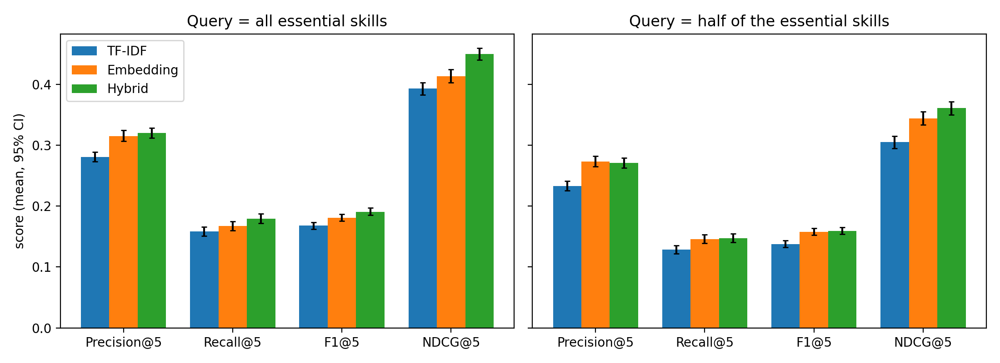

# TF-IDF vs. sentence embeddings vs. hybrid matching on the ESCO occupation dataset

Code and data for the comparison reported in our research paper / bachelor project
*AI-Driven Platform for Personalized Global Opportunity Matching* (Kardan University).
Everything is re-computable: open the notebook, press **Run all**, and the tables and graph are produced from the data files in this repository.

## What is compared
| Method | Description |
|---|---|
| TF-IDF | scikit-learn `TfidfVectorizer` (1–2-grams, sublinear TF, English stop words) + cosine similarity |
| Embedding | `sentence-transformers/all-MiniLM-L6-v2` (not fine-tuned) + cosine similarity |
| Hybrid | 0.5 × TF-IDF + 0.5 × Embedding, each score min–max scaled per query (weight fixed before any run) |

## Two independent evaluations
**A. Full-dataset benchmark (all 3,043 ESCO occupations, ground truth from ESCO itself)** — `ESCO_benchmark.ipynb`, `esco_benchmark.py`
* Query = the essential skills of one occupation (`full`) or a random half of them (`half`, seed 42). 3,042 occupations have ≥ 4 essential skills and are used as queries.
* Documents = title + alternative names + description. The skills are **not** in the document text.
* Relevant = the same occupation (grade 2) or another occupation in the same ISCO-08 4-digit group (grade 1).
* Metrics @5: **Precision, Recall, F1, NDCG** (+ Hit@1, Hit@5, MRR of the exact occupation), 95 % bootstrap CIs, paired Wilcoxon tests against TF-IDF with Holm correction.
* The `ceiling` row gives the best score any method could reach (many ISCO groups hold fewer than 5 occupations, so Precision@5 cannot reach 1).
* The hybrid-weight sweep is a sensitivity analysis only; it is not used to pick the weight.

**B. Human judgments (50 profiles, 432 judged pairs)** — `judgments_*.csv`, `rankings.csv`, `evaluate_human_judgments.py`
Top-5 results of the three methods were pooled, shuffled and scored 0/1/2 blind by three team members (80 pairs scored twice).
`python evaluate_human_judgments.py` reproduces the numbers in the paper (Precision@5 0.928 / 0.936 / 0.944 for TF-IDF / Embedding / Hybrid; no difference significant).

## Run
Colab: open `ESCO_benchmark.ipynb` in Colab, then *Runtime → Run all* (about 5–10 min, CPU is enough).

Local:
```
pip install -r requirements.txt
python esco_benchmark.py            # results/ gets summary_sbert.csv, significance_sbert.csv, comparison_sbert.png
python evaluate_human_judgments.py
```
The two `esco_*.csv` files were built from the official ESCO v1.2.1 CSV download with `prepare_esco_data.py` (run it yourself to verify).

## Results (Google Colab run, MiniLM-L6, 3,042 queries, K = 5)
Files: `summary_sbert.csv`, `significance_sbert.csv`, `comparison_sbert.png` (upload them to this repository).

| Query = all essential skills | TF-IDF | Embedding | Hybrid (0.5/0.5) |
|---|---|---|---|
| Precision@5 | 0.281 | 0.315 | **0.320** |
| Recall@5 | 0.159 | 0.167 | **0.179** |
| F1@5 | 0.168 | 0.181 | **0.191** |
| NDCG@5 | 0.393 | 0.413 | **0.450** |
| Hit@1 | 0.320 | 0.314 | **0.380** |
| MRR | 0.458 | 0.452 | **0.522** |

Ceiling (best possible): Precision@5 0.930, Recall@5 0.498.
Hybrid vs TF-IDF: all differences significant (paired Wilcoxon, Holm, p < 0.001). Embedding vs TF-IDF: significant for P, R, F1, NDCG; not for MRR (p = 0.78).
With half of the skills, the same order holds (NDCG@5 0.305 / 0.344 / 0.361).
Conclusion: the hybrid is the best method on this benchmark and is the default mode of the GOP platform. Hybrid vs embedding was not tested directly; the TF-IDF weight sweep (best 0.25) is a sensitivity analysis only and was not used to choose the weight.



## Limitations (please read)
* Ground truth in A is ESCO's own classification, not human relevance. "Same ISCO group" is a reasonable but imperfect notion of relevance, and queries are skill lists of ESCO occupations, not real CVs.
* Both evaluations are English-only and MiniLM-L6 is an English model; Dari/Pashto matching is not evaluated.
* Evaluation B uses 50 synthetic profiles written by the team, team-member judges and has fair agreement only (weighted kappa 0.30).
* No model was trained or tuned; results show which of the three methods works better on this data, not that it is best possible.

## Data and licence
ESCO © European Union, reused under the ESCO terms (https://esco.ec.europa.eu/en/about-esco/terms-use). Code: MIT (add a LICENSE file before publishing if you agree).
